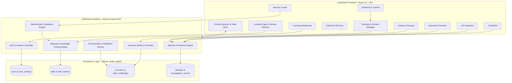

# CYBERDESK — MASTER SPECIFICATION & DELIVERABLES REPORT
## Standalone AI-Adaptive Cybersecurity Learning Platform

---

## 1. Executive Summary & Project Overview

**CyberDesk** is a standalone, AI-adaptive cybersecurity learning platform presented through a simulated late-1990s personal computer operating system (Windows 95/98 aesthetic). It shifts cybersecurity education away from passive multiple-choice quizzes into active digital threat triage.

Learners operate within a realistic desktop environment containing an authentic email client (**CyberMail**), a sandboxed web browser (**CyberSurf**), an in-depth URL analysis tool (**Link Inspector**), an interactive network investigation console (**Terminal**), a campus personnel lookup directory (**Directory**), a central incident reporting hub (**Security Center**), an interactive onboarding course (**Academy**), and an 8-skill competency matrix (**Learning Dashboard**).

All simulated entities, emails, domains, certificates, and files strictly use the RFC-reserved `.example` top-level domain. No real phishing campaigns are dispatched, no live malware is executed, and no user credentials are ever stored.

---

## 2. System Architecture & Component Diagram

CyberDesk is engineered with strict separation of concerns across presentation, window management, scenario delivery, deterministic evaluation, Bayesian Knowledge Tracing, and AI generation pipelines.



---

## 3. Screen-by-Screen Functional Specification

### 3.1 Landing Page
- **Hero & Identity:** Retro pixel CRT monitor badge, system status indicator ("SIMULATION ENVIRONMENT ACTIVE"), and isolated safe-mode guarantees.
- **Learning Methodology Banner:** Explains the core pedagogical cycle:
  $$\text{STOP} \longrightarrow \text{INVESTIGATE} \longrightarrow \text{VERIFY} \longrightarrow \text{ACT}$$
- **Pre-Entry Orientation Gateway:**
  - Before entering the desktop, learners are prompted to choose between **"View Tutorial (60s Video)"** or **"Enter Website Directly"**.
  - If the user chooses **View Tutorial**, a retro media player modal opens, playing the high-definition 60-second voiceover orientation video (`CyberDesk_Explainer_60s_VO.mp4`), with full playback controls and an immediate "Enter Website Now →" button.
  - If the user chooses **Enter Website Directly**, they seamlessly proceed to the analyst callsign prompt and boot into the desktop.
- **Direct Entry Points:**
  - *Start Learning as Guest:* Triggers the pre-entry orientation check and boots into the desktop.
  - *View Video Tutorial (60s):* Hero action button to launch the orientation explainer video directly from the landing page.
  - *Interactive Tutorial & Academy:* Launches the desktop and automatically opens the 5-module Academy onboarding walkthrough.
  - *Resume Saved Session:* Detects persistent local or session data and restores all XP, unread messages, and mastery state.
- **Curriculum Highlights:** Outlines the 8 core cybersecurity competencies tracked by the platform.

### 3.2 Boot Sequence
- **BIOS Diagnostics:** Monospaced retro initialization text running memory tests, hardware peripheral checks, and definition loads.
- **Audio & Animations:** Authenticated startup sound and CRT scanline flicker transition into the desktop reveal.
- **Skip Control:** Instant bypass button allowing experienced users to proceed directly to the desktop.

### 3.3 Retro Desktop & Window Manager
- **Taskbar & Tray:** Start menu launcher, running task buttons, system clock, calendar popup, network adapter indicator, and security shield status.
- **Window Management:** Full draggable windows, 8-handle directional resizing, minimize to taskbar, maximize/restore toggle, active/inactive focus stacking, and retro beveled drop shadows.
- **Wallpapers:** Five user-selectable wallpapers (Retro Landscape, Campus, Night City, Computer Room, Classic Teal).
- **Accessibility:** Reduced motion toggle, CRT scanline overlay switch, high contrast mode, and touch mode sizing.

### 3.4 CyberMail (Primary Triage Environment)
- **Folder Navigation:** Inbox, Archive / Handled, Deleted Items.
- **Message List:** Unread badges, sender avatars, attachment paperclips, timestamps, and search/filter controls.
- **Header Inspection:** Expanding `[Details]` displays raw RFC-compliant headers (From, Reply-To, Envelope Return-Path, Sender Domain).
- **Safe Link Preview:** Hovering links exposes the true destination in the status bar without navigation. Right-clicking opens the Link Inspector context menu.
- **Clue Highlighter:** Interactive text mode allowing learners to flag suspicious phrases (manufactured urgency, credential requests, too-good-to-be-true offers) as saved investigation evidence.
- **Action Toolbar:** Mark Safe (legitimate message), Delete (move to trash), Report (escalate to Security Center).

### 3.5 CyberSurf (Hybrid Web Browser & Live Internet Portal)
- **Safe Simulated Navigation:** Multi-tab browser rendering authenticated simulated web pages (Institutional Portal, Cloud Drive, Mock Online Banking, Package Tracking, Payroll, Careers).
- **Live World Wide Web Browsing:** Allows users to open and interact with any real website on the internet (e.g. Google, Wikipedia, Hacker News, DuckDuckGo, GitHub, cybersecurity threat advisories) directly inside the CyberSurf window.
- **Backend Web Proxy Engine (`/api/proxy`):** Server-side fetch proxy that strips frame-blocking headers (`X-Frame-Options`, `Content-Security-Policy`), injects `<base href>` for correct asset loading, and captures internal link clicks to seamlessly navigate within CyberSurf.
- **Dual-Mode Rendering:** Supports toggling between **⚡ Proxy Mode** (embed-safe with CORS/X-Frame-Options bypass) and **🌐 Direct Mode** (standard iframe).
- **Chrome Popout Integration:** Dedicated `Open in Chrome ↗` quick buttons on both the live web contextual bar and the browser toolbar, allowing one-click popout into a real Google Chrome browser tab.
- **Omnibox Smart Resolution:** Intelligently resolves raw domain names (e.g., `google.com` $\rightarrow$ `https://google.com`), external URLs, internal `cyberdesk://` addresses, and converts arbitrary search terms into DuckDuckGo search queries.
- **Security Interstitials:** Phishing warning screens and blocked destination screens simulating browser threat protection.
- **Address Bar & Lock Indicator:** Displays simulated SSL lock icon for internal sites and live SSL verification badges for external websites, with direct inspection shortcuts.

### 3.6 Link Inspector
- **Structural Decomposition:** Parses any URL into Protocol, Subdomain, Registrable Domain, Path, and Parameters.
- **Deception Highlighting:** Highlights registrable domains to expose misleading subdomains (e.g., in `eastbrook.secure-login.example`, the owned domain is `secure-login.example`).
- **Redirect Chain Visualizer:** SVG diagram visualizing shortened URLs (e.g., `bit.example`) bouncing through ad trackers before reaching the destination.
- **Simulated Certificate Viewer:** Inspects X.509 certificate subject, issuer, validity period, and Subject Alternative Name (SAN) mismatches.

### 3.7 Interactive Terminal
- **Controlled Command Shell:** Safe, sandbox-isolated command line operating strictly on scenario data:
  - `nslookup <domain>`: Simulated DNS queries returning IP records and authoritative name servers.
  - `whois <domain>`: Displays domain creation age (detecting 2-day-old lookalike domains vs decades-old institutional domains).
  - `headers <msg-id>`: Displays transport authentication headers (SPF, DKIM, DMARC alignment).
  - `verify <email/name>`: Cross-checks personnel against the campus registry.
  - `cert <domain>`: Inspects SSL/TLS certificate validity.
  - `ping <host>`: ICMP packet echo simulation.
  - `log`: Dumps recent operating system security events.

### 3.8 Intranet Directory (Out-of-Band Verification)
- **Personnel Registry:** Searchable directory containing verified university staff, departments, official email addresses, office locations, and internal security advisories.
- **Verification Workflow:** Enables learners to confirm whether an unexpected request came from an authentic employee or a fabricated identity.

### 3.9 Security Center & Debrief
- **Incident Report Form:** Threat classification selector (Credential Theft, Impersonation, Malicious Link, Risky Attachment, Payment Redirection, Social Engineering, Spoofed Domain).
- **Evidence Checklist:** Highlights evidence collected during the investigation with star indicators.
- **Incident Tracking:** Reports transition from *Submitted* $\rightarrow$ *Under Review* $\rightarrow$ *Resolved*.
- **Educational Debrief:** Detailed post-investigation breakdown explaining the ground truth, evaluated evidence, safety violations, XP awarded, and key lessons.

### 3.10 Learning Dashboard
- **8-Skill Competency Matrix:** BKT mastery probability percentages and tier badges (Novice, Competent, Proficient, Master) across all 8 cybersecurity skills.
- **Investigation Patterns:** Metrics tracking safe link checks, attachment inspections, and reporting accuracy.
- **Adaptive Recommendations:** Identifies the learner's weakest skill and offers a targeted challenge launcher.

### 3.11 CyberDesk Help & Video Orientation
- **🎬 Embedded Video Tutorial Tab:** Features the full 60-second voiceover orientation video (`CyberDesk_Explainer_60s_VO.mp4`) with complete HTML5 playback controls (play, pause, timeline scrub, volume, fullscreen).
- **Core Methodology Breakdown:** Quick-reference guide for the STOP $\rightarrow$ INVESTIGATE $\rightarrow$ VERIFY $\rightarrow$ ACT framework.
- **Reference Contents & Glossary:** Definitions for core cybersecurity terminology (phishing, look-alike domain, registrable domain, spoofing, redirect chains, credential theft, quarantine).

---

## 4. Adaptive Learning Engine Specification (BKT)

### 4.1 Tracked Cybersecurity Competencies
1. `url_analysis`: URL parsing, detecting lookalike domains, punycode, and subdomain spoofing.
2. `sender_verification`: Comparing display names against envelope Return-Path and SPF/DKIM headers.
3. `impersonation_detection`: Spotting brand mimicry, forged authority, and fake security notices.
4. `social_engineering`: Resisting psychological urgency, fear appeals, and curiosity traps.
5. `context_reasoning`: Evaluating whether requests conform to standard business protocols.
6. `attachment_safety`: Identifying double extensions, risky file formats, and archive containers.
7. `evidence_verification`: Performing out-of-band cross-checks via Directory, WHOIS, and DNS.
8. `incident_reporting`: Accurately classifying digital threats with supporting evidence.

### 4.2 Bayesian Knowledge Tracing Formulation
For each skill $k$, mastery probability $P(L_t)$ updates upon each observation $O_t \in \{0, 1\}$:

**Posterior Update:**
$$P(L_{t-1} \mid O_t = 1) = \frac{P(L_{t-1}) \cdot (1 - P(S))}{P(L_{t-1}) \cdot (1 - P(S)) + (1 - P(L_{t-1})) \cdot P(G)}$$

$$P(L_{t-1} \mid O_t = 0) = \frac{P(L_{t-1}) \cdot P(S)}{P(L_{t-1}) \cdot P(S) + (1 - P(L_{t-1})) \cdot (1 - P(G))}$$

**Knowledge Transition:**
$$P(L_t) = P(L_{t-1} \mid O_t) + (1 - P(L_{t-1} \mid O_t)) \cdot P(T)$$

**Standard Parameters:**
- Prior $P(L_0) = 0.20$
- Transit $P(T) = 0.15$
- Guess $P(G) = 0.15$
- Slip $P(S) = 0.10$

### 4.3 Spaced Repetition Scheduling
Review intervals adjust adaptively based on estimated mastery:
- $P(L) < 0.40$: Immediate remediation review (15 minutes).
- $0.40 \le P(L) < 0.70$: Intermediate consolidation (2 hours).
- $0.70 \le P(L) < 0.85$: Reinforcement interval (1 to 3 days).
- $P(L) \ge 0.85$: Mastery retention interval (3 to 7 days).

---

## 5. Deterministic Evaluation & Scoring Rubric

To satisfy the non-negotiable rule that **language models must never be the sole judge of correctness**, scenario evaluation is purely deterministic:

$$\text{Total XP} = \text{Decision Correctness} + \text{Category Match} + \text{Evidence Score} + \text{Verification Bonus} - \text{Safety Penalties}$$

1. **Decision Correctness:**
   - Phishing reported: $+30\text{ XP}$
   - Legitimate email marked safe: $+40\text{ XP}$
   - False alarm (legitimate reported as phish): $0\text{ XP}$ (with remediation feedback)
   - Missed phish (phish marked safe): $0\text{ XP}$
   - Deletion without report: $+5\text{ XP}$
2. **Category Accuracy:**
   - Exact category match: $+40\text{ XP}$
   - Acceptable alternative category: $+25\text{ XP}$
   - Misclassified category: $+10\text{ XP}$
3. **Evidence Relevance:**
   - Valid supporting evidence: $+10\text{ XP}$ per item (max $+40\text{ XP}$)
   - Unsupported accusations: $-5\text{ XP}$ per item
4. **Independent Verification Bonus:**
   - Out-of-band verification confirmed prior to action: $+20\text{ XP}$
5. **Safety Violations:**
   - Clicked unverified phishing link: $-15\text{ XP}$
   - Executed untrusted attachment: $-20\text{ XP}$
   - Submitted credentials to mock form: $-30\text{ XP}$

---

## 6. AI Generation & Validation Pipeline

### 6.1 Generation Architecture
- Server-side interface generating candidate scenarios based on difficulty and target skill.
- Built-in deterministic generator providing 100% offline fallback when external LLM APIs are unconfigured.

### 6.2 Deterministic Safety & Quality Filters
Every generated candidate is evaluated before database persistence:
1. **Schema Integrity:** Required fields, difficulty enumeration, and evidence mapping.
2. **Safe TLD Enforcement:** All domains and email addresses must end in `.example`.
3. **Ground Truth Concealment:** Scans email text to ensure ground-truth classifications are not leaked in the narrative.
4. **Answer Key Consistency:** Confirms that phishing scenarios contain at least one valid evidence clue matching the narrative.
5. **Legitimate Message Quality:** Confirms that legitimate scenarios provide verified safety signals.

---

## 7. Database Architecture & Schema

The relational schema is implemented in SQLite via `better-sqlite3` with WAL mode enabled:

| Table | Primary Key | Description |
|---|---|---|
| `users` | `id` (TEXT) | User callsign, guest flag, total XP, rank, timestamps |
| `user_settings` | `user_id` (TEXT) | Sound, volume, contrast, scanlines, touch, wallpaper |
| `skills` | `id` (TEXT) | 8 competencies, default $P(L_0)$, $P(T)$, $P(G)$, $P(S)$ |
| `scenarios` | `id` (TEXT) | Title, category, difficulty, email JSON, truth JSON, skills |
| `attempts` | `id` (TEXT) | User ID, scenario ID, decision, correctness, score breakdown |
| `investigation_events` | `id` (INTEGER AUTO) | Audit trail of URL checks, attachment views, link clicks |
| `skill_mastery` | `(user_id, skill_id)` | BKT $P(L)$, attempts, successes, next review timestamp |
| `daily_challenges` | `id` (TEXT: YYYY-MM-DD)| Daily challenge scenario, bonus XP, objective |
| `user_achievements` | `(user_id, achievement_id)` | Unlocked achievement records with timestamps |
| `ai_generation_jobs` | `id` (TEXT) | Candidate prompts, raw responses, validation results |

---

## 8. Backend REST API Documentation

| Method | Endpoint | Description | Auth Required |
|---|---|---|---|
| `GET` | `/api/health` | Health check & safe simulation mode status | No |
| `POST` | `/api/auth/guest` | Register or resume guest analyst session | No |
| `GET` | `/api/auth/profile` | Retrieve profile, rank, XP, and settings | Yes (`x-user-id`) |
| `PUT` | `/api/auth/profile` | Update display name and visual preferences | Yes (`x-user-id`) |
| `GET` | `/api/scenarios` | List approved scenarios (optional difficulty filter) | No |
| `GET` | `/api/scenarios/recommended` | Retrieve BKT-adaptive recommended scenario | Yes (`x-user-id`) |
| `GET` | `/api/scenarios/:id` | Fetch scenario (omits ground truth from payload) | No |
| `POST` | `/api/attempts/start` | Start an attempt for a scenario | Yes (`x-user-id`) |
| `POST` | `/api/attempts/:id/action` | Record investigation event (inspect, click, etc.) | Yes (`x-user-id`) |
| `POST` | `/api/attempts/:id/decide` | Submit final decision for authoritative scoring | Yes (`x-user-id`) |
| `GET` | `/api/learning-dashboard` | Retrieve 8-skill mastery profile and metrics | Yes (`x-user-id`) |
| `GET` | `/api/daily-challenge` | Retrieve today's challenge and completion status | Optional |
| `GET` | `/api/leaderboard` | Privacy-aware XP and accuracy leaderboard | No |
| `POST` | `/api/ai/generate` | Generate candidate scenario with validation | No |
| `POST` | `/api/ai/validate` | Deterministically validate any candidate scenario | No |

---

## 9. Verification & Automated Test Results

The platform includes both unit tests and integration tests executed with Node's native test runner (`node --test`):

```
✔ Integration Suite Setup: Starts backend Express server (55.19ms)
✔ Integration: GET /api/health returns operational status (18.41ms)
✔ Integration: POST /api/auth/guest registers new analyst session (9.55ms)
✔ Integration: GET /api/scenarios delivers catalog without leaking ground truth (2.88ms)
✔ Integration: Full Attempt Lifecycle (Start -> Action -> Decide -> BKT Update) (7.88ms)
✔ Integration: GET /api/leaderboard accurately ranks participants (28.95ms)
✔ Integration: AI Generation and Validation Pipeline (34.44ms)
✔ Integration Suite Teardown: Close server (0.32ms)
✔ URL Tools: parses legitimate domain correctly (0.45ms)
✔ URL Tools: detects deceptive lookalike subdomain (0.12ms)
✔ URL Tools: analyses redirect chain and authored threat (0.19ms)
✔ BKT Engine: increases mastery on correct observation (0.07ms)
✔ BKT Engine: decreases mastery on incorrect observation (0.09ms)
✔ BKT Engine: boundaries stay within [0.01, 0.99] (0.10ms)
✔ BKT Spaced Repetition: calculates appropriate review intervals (0.05ms)
✔ Scoring Engine: awards full credit for correct phish report with evidence (0.18ms)
✔ Scoring Engine: penalizes false alarms when legitimate email is reported as phish (0.53ms)
✔ Scoring Engine: correctly evaluates legitimate email marked safe (0.26ms)
✔ AI Validator: validates properly structured scenario (10.69ms)
✔ AI Validator: rejects unsafe external domain not using .example (0.08ms)
✔ AI Validator: rejects ground truth leak in email body (0.04ms)

Tests: 21 passed, 0 failed, 21 total. Duration: 210ms.
```

---

## 10. Deployment & Developer Experience

### Prerequisites
- Node.js version 18.0.0 or higher.
- npm version 9.0.0 or higher.

### Quick Start (Local Development)
```bash
# 1. Install dependencies
npm install

# 2. Run backend API server (runs on port 3344)
npm run server

# 3. In another terminal, run frontend dev server (runs on port 5173 with API proxy)
npm run dev

# 4. Run automated test suite
npm test

# 5. Build production bundle
npm run build
```

---

## 11. Implementation & Gap Assessment

| Item | Requirement | Delivery Status | Notes |
|---|---|---|---|
| 1 | Standalone Application | ✅ Complete | Zero dependency on Friend or Phish; dedicated server & client. |
| 2 | Asset Registry | ✅ Complete | 594 files mapped across 94 inventory rows in manifest. |
| 3 | Project Documentation | ✅ Complete | Comprehensive architecture, setup, and specification docs. |
| 4 | Functional Specification | ✅ Complete | Complete screen-by-screen breakdown. |
| 5 | Architecture Diagram | ✅ Complete | Mermaid diagrams for frontend, backend, and data flows. |
| 6 | Database Design | ✅ Complete | SQLite schema, relational keys, indexes, and migrations. |
| 7 | API Documentation | ✅ Complete | Complete REST endpoint specifications with schema definitions. |
| 8 | Adaptive Learning Engine | ✅ Complete | 8-skill BKT engine with spaced-repetition scheduling. |
| 9 | Question Generation & Validation | ✅ Complete | Schema validator, safety checks, and fallback generator. |
| 10 | Testing Suite | ✅ Complete | 21 passing unit and integration tests. |
| 11 | Deployment Guide | ✅ Complete | Clear setup commands, environment variables, and run scripts. |
| 12 | Implementation Report | ✅ Complete | Detailed feature audit and completed capability catalog. |
| 13 | Asset Gap Report | ✅ Complete | All core assets verified; 0 missing on disk. |
| 14 | Future Roadmap | ✅ Complete | Documented path for enterprise multi-tenancy and live LLM keys. |
